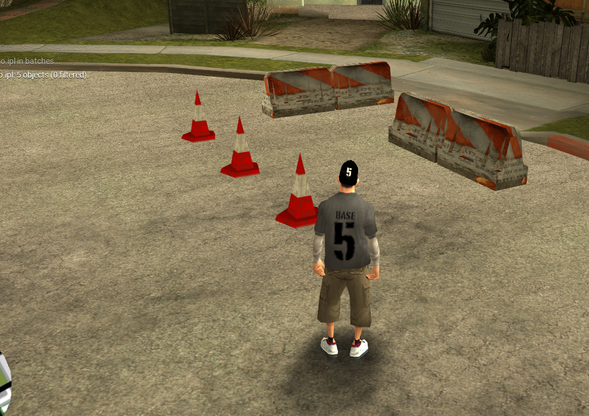
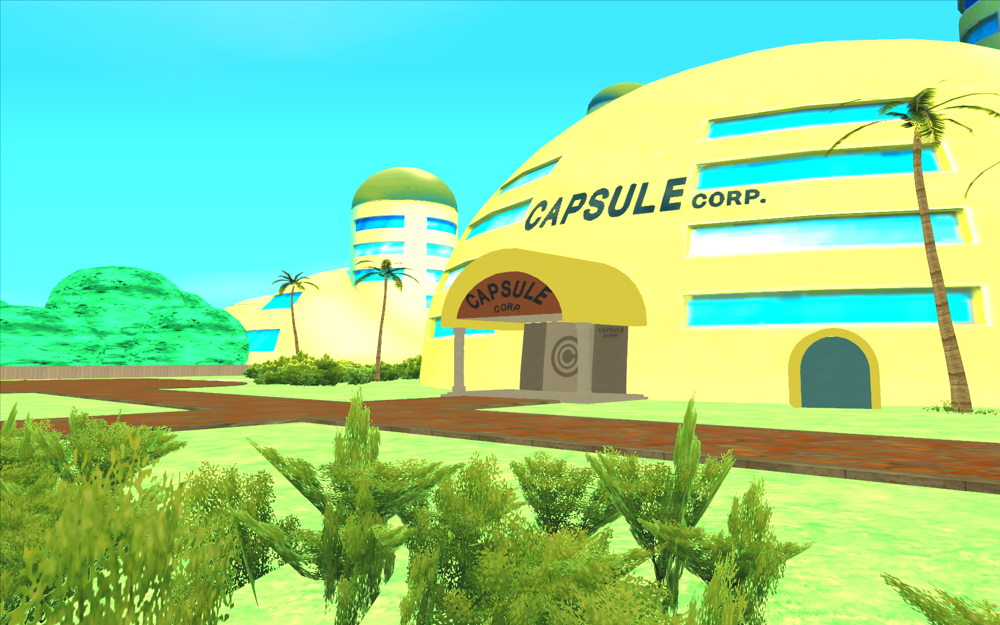

# IPL Loader

Use existing IPL placements in your Legacy Multiplayer scripts without
rewriting each object by hand. The loader reads the file and manages the
objects as one map, from creation through cleanup.

## Features

- Reads object placements from text IPL `inst` sections.
- Optionally creates vehicles from `cars` and mapped pickups from `pick`.
- Registers custom objects from IDE `objs` definitions.
- Converts IPL quaternion rotations to GTA-compatible Euler angles.
- Supports stock IDs, registered custom IDs and ID/name mappings.
- Offers position offsets, dimensions, interior filtering and draw distance.
- Creates objects in batches instead of one large spawn loop.
- Skips referenced LOD placements by default to avoid low-detail duplicates.
- Reports malformed records with their filename and line number.
- Cancels pending batches and removes created objects on request.
- Rolls back a map's created objects if a later object cannot be created.

## Installation

**Requires [Addon-Sscanf](https://github.com/Legacy-Multiplayer/Addon-Sscanf/releases).**
Install `Addon-Sscanf.dll` (Windows) or `Addon-Sscanf.so` (Linux) in the server's
`addons/` folder and restart the server. IPL and IDE records use its native
`sscanfTable` function; no Lua adapter is needed.

Clone the repository:

```bash
git clone https://github.com/Legacy-Multiplayer/IPL-Loader.git
```

Copy `ipl.lua` into your server's `includes` directory, and put your IPL files
somewhere your script can read, such as `resources/maps`:

```text
server/
├── includes/
│   └── ipl.lua
├── main/
│   └── main.lua
└── resources/
    └── maps/
        └── grove-demo.ipl
```

The server must expose `sscanfTable`, `createWorldObject`, `removeWorldObject`, `createTimer`
and `removeTimer`. Use Legacy's essential **Object** addon for the object
functions; timers are provided by the server. The include uses Lua 5.3+ and
Lua's standard file access. No additional Lua dependencies are needed.

Copy `ide.lua` into `includes/` too if you use IDE registration. Enable the
Model and Constants addons for that feature, Vehicle for `cars`, and Pickup
for `pick`. Vehicles and pickups are disabled unless explicitly requested.

## Quick start

Copy `examples/maps/grove-demo.ipl` into `resources/maps`, then add this to
your main script:

```lua
local IPL = require("ipl")
local map

addEventHandler("onMainScriptInit", function()
    local problem
    map, problem = IPL.load("resources/maps/grove-demo.ipl", {
        dimension = 0,
        interior = 0,
    })
    assert(map, problem)

    local started, startError = map:spawn(function(result, success, why)
        if success then
            print("Loaded " .. #result.objects .. " IPL objects")
        else
            print("IPL load failed: " .. tostring(why))
        end
    end)
    assert(started, startError)
end)

addEventHandler("onMainScriptExit", function()
    if map then
        map:destroy()
    end
end)
```

The sample places five stock objects near Grove Street at their original
coordinates. The include does not spawn or teleport players. A complete Grove
Street script with `/ipl`, `/unloadipl` and vehicle commands is provided in
[`examples/main.lua`](examples/main.lua).



## Load options

```lua
local map, problem = IPL.load("resources/maps/city.ipl", {
    dimension = 0,
    interior = 0,
    offset = { x = 8000, y = 0, z = 0 },
    drawDistance = 400,
    batchSize = 32,
    skipLOD = true,
})
```

| Option | Default | Behavior |
| --- | --- | --- |
| `dimension` | `0` | Dimension in which objects are created, from `0` to `65535`. |
| `interior` | Unset | Selects placements whose interior byte matches. Unset includes all interiors. |
| `offset` | `{x=0, y=0, z=0}` | Adds the same world-space offset to each placement. |
| `drawDistance` | `400` | Object draw distance; greater than `0`, up to `3000`. |
| `batchSize` | `32` | Objects per 50 ms batch, from `1` to `128`. |
| `skipLOD` | `true` | Excludes placements referenced by another placement's LOD index. |
| `models` | Unset | Maps original IDs or model names to stock/custom IDs. |
| `ide` | Unset | Catalogue returned by `IPL.registerIDE`. Maps its custom objects and uses their IDE draw distances unless `drawDistance` is supplied. |
| `vehicles` | `false` | Create server vehicles from `cars`. |
| `vehicleModels` | Unset | Replace vehicle model IDs, e.g. `{[520] = 506}`. |
| `vehicleRespawnDelay` | `60` | Server vehicle respawn delay in seconds; `-1` disables respawning. |
| `pickups` | Unset | Explicit mapping from IPL pickup codes to `{model=..., type=...}`. |

Dimensions and native GTA interiors are different concepts. `interior` filters
records; it does not change the player's interior or configure native IPL
streaming flags. Offsets translate placements without changing their rotations.

If `models` is supplied, **every selected placement must have a mapping**.
Numeric ID mappings take precedence over name mappings. An unmapped model
produces an error instead of silently spawning the wrong asset.

## Custom models

Custom models use the same loader. Register their DFF/TXD/COL files with
`registerCustomModel` during `onMainScriptInit`, before players join and before
spawning the map. If the IPL already uses those registered IDs, no mapping is
needed.

For an IPL that still contains its original IDs, provide a mapping:

```lua
-- After registering custom object 160001, map the sample's cones to it.
-- Keep the sample's barriers as stock objects.
local map, problem = IPL.load("resources/maps/grove-demo.ipl", {
    interior = 0,
    models = {
        [1238] = 160001,
        [1422] = 1422,
    },
})
assert(map, problem)
```

### Optional IDE registration

Place each object's `name.dff` and single-model `name.col`, plus its texture
dictionary's `txdName.txd`, under a directory inside `assets/`.

```lua
local IPL = require("ipl")
local map

addEventHandler("onMainScriptInit", function()
    local catalogue, problem = IPL.registerIDE("resources/maps/custom.ide", {
        assetPath = "maps/custom", -- Relative to assets/.
        firstModelId = 220001,
        baseModel = 1337,
    })
    assert(catalogue, problem)

    map, problem = IPL.load("resources/maps/custom.ipl", { ide = catalogue })
    assert(map, problem)
    assert(map:spawn())
end)

addEventHandler("onMainScriptExit", function()
    if map then map:destroy() end
end)
```

Registration uses unused custom IDs starting at `firstModelId`; it does not
replace GTA's native model slots. The returned catalogue contains `models`,
`drawDistances` and `definitions`. Stock IPL IDs absent from the catalogue are
kept unchanged. An explicit `models` option retains its existing strict mapping
behavior and takes precedence.

Supported IDE entries are static `objs` definitions with zero native flags,
including the optional 1–3 mesh-distance form. Nonempty `tobj` sections are
rejected; other IDE sections are ignored. File names must match the IDE names
on case-sensitive systems. COL collections must be split into one model per
file beforehand. This helper does not convert DFF/TXD/COL data.

All asset paths are checked before registration. Native validation still runs
for every model. If a later registration fails, reload the owning script to
release any earlier registrations. Register at initialization, before players
join. Legacy handles downloads; successful registration does not prove native
loading or rendering on a client.

The [Capsule Corp example](examples/capsule/README.md) shows the complete setup,
including IDE registration, stock vehicles, a pickup and a teleport command.
Map by **Kerblaz 398**; screenshot taken in Legacy Multiplayer.



## Vehicles and pickups

```text
cars
2490, -1668, 14, 1.570796, 506, 1, 1, 0, 0, 0, 0, 0
end
pick
19, 2495, -1668, 14
end
```

```lua
local map, problem = IPL.load("resources/maps/scene.ipl", {
    vehicles = true,
    vehicleRespawnDelay = 60,
    pickups = {
        [19] = { model = 348, type = 1 },
    },
})
assert(map, problem)
assert(map:spawn())
```

`cars` fields are XYZ, heading in radians, model, two colours, flags, alarm
chance, lock chance, minimum delay and maximum delay. The loader converts the
heading to degrees and creates a normal server vehicle in the map's dimension.
It uses `vehicleRespawnDelay` rather than GTA's offline generator delay range.
Nonzero generator flags/alarm/lock chances are rejected because these behaviors
are not emulated. Map a random-model entry (`-1`) to a specific model with
`vehicleModels` before loading it.

`pick` contains an IPL pickup code and XYZ. That code is not a Legacy model or
weapon ID. Supply its desired pickup model and Legacy pickup type explicitly;
an unmapped enabled code is an error. Both sections use the map's position
offset and are treated as exterior placements.

## API

### `IPL.load(path, options)`

Returns `map`, or `nil, error`. Reads and validates the complete file before
creating anything. Paths are relative to the server's working directory unless
an absolute path is supplied. Only load paths permitted by your script.

### `map:spawn(onComplete)`

Returns `true` when batching starts, or `false, error` if it cannot start.
`onComplete(map, success, error)` runs when creation finishes or fails. A map
which is already loading or spawned cannot be spawned again.

If creation fails, objects, vehicles and pickups created by that spawn are
removed. The loader does not alter the game's original world.

### `map:destroy()`

Cancels the pending timer, removes the map's objects, vehicles and pickups, and returns the map to
`idle`. It can be called more than once. You can spawn the map again afterward.
Cancelling a load does not invoke its completion callback.

### `IPL.parse(text, sourceName)`

Returns the parsed placement list, or `nil, error`, using Addon-Sscanf without
creating entities or timers. `sourceName` labels errors. Entries contain `model`, `name`, `flags`,
`interior`, `x`, `y`, `z`, `rx`, `ry`, `rz`, `lod`, `line` and `index` for objects.
Each entry has `kind` (`object`, `vehicle` or `pickup`). Vehicle entries include
heading, colours and generator metadata; pickup entries include `code`.
`index` and `lod` follow zero-based object indexing only; other sections do not
change them. `lod=-1` means no LOD link.

### `IPL.rotation(qx, qy, qz, qw)`

Returns GTA Euler degrees as `rx, ry, rz`. Normalizes the quaternion and applies
IPL's conjugate convention. Invalid components/zero quaternions raise an error.

### Map fields

| Field | Meaning |
| --- | --- |
| `state` | `idle`, `loading`, `spawned` or `failed`. |
| `objects` | IDs of created objects; object ID `0` is valid. |
| `vehicles` | IDs of created server vehicles. |
| `pickups` | IDs of created dynamic pickups. |
| `entries` | Selected placements after filtering/mapping. |
| `total` | Number of parsed placements before filtering. |
| `filtered` | Number excluded by interior/LOD filtering. |
| `path` | Source IPL path. |
| `offset` | Translation applied when creating objects. |

## Supported format and limits

San Andreas **text IPL**, with 11 fields per `inst` record:

```text
inst
1238, trafficcone, 0, 2493, -1678, 13.15, 0, 0, 0, 1, -1
end
```

The fields are model ID, model name, instance flags/interior, XYZ position,
quaternion XYZW and the zero-based LOD index.

- `cars` and `pick` are parsed but only spawned when enabled. Other sections, including `occl` and `tcyc`, are ignored.
- Binary IPL and GTA III/VC placement formats are not supported.
- Native instance flags beyond the interior byte and automatic LOD linking are not implemented.
- Referenced LOD filtering does not identify standalone LOD meshes by their names.
- Maximum file size is 8 MiB; maximum placement count is 20,000.
- Native/server/client object limits still apply. Large maps can exceed them.
- Parsing happens before spawning; batching spreads object creation, not file parsing.
- Loading a stock GTA IPL at its original coordinates duplicates existing scenery.

## Checks

GitHub Actions runs the Lua checks inside Legacy Server with the released
Addon-Sscanf plugin loaded. Checks cover typed parsing, extra/missing fields,
dependency errors, quaternion rotations, IDE mapping, mixed-entity batching,
cancellation and rollback. Entity creation is mocked for these parser checks;
the scanner is the actual native addon. Gameplay and appearance require
separate client testing.

## License

[MIT](LICENSE) for the loader and example scripts. Capsule Corp model assets
are separate; credit belongs to Kerblaz 398 and the original contributors.
